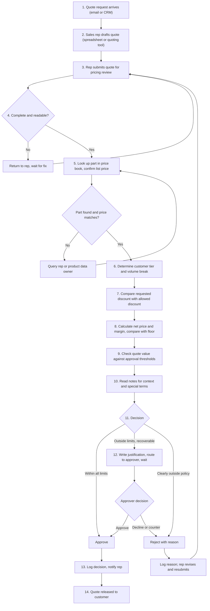

# Step 1 — Discovery: Quote Review Before Quotes Go Out

> **PRACTICE PROJECT — FICTIONAL DATA.** This document is part of a learning exercise. All customers, part numbers, prices, costs, rules, and approver titles are invented. Nothing here describes a real company, product, or internal process. The process map and pain points are **hypotheses** to test in an interview, not findings. A human must review every output before it is used.

**Version:** 0.1.0 · **Status:** draft for your review · **Related files:** `rules/rulebook_v1.0.md`, `data/sample_quotes.csv`, `data/price_book.csv`

---

## Part A — Ten interview questions for a pricing expert

**Before you go in:** ask for 30–45 minutes and permission to take notes. Ask for a *walk-through of a real example* rather than a description of "how it usually works"; people describe the clean version of their process unless you anchor them to a case. Don't ask for, or write down, real customer names, real prices, or anything your interviewee's employer would consider confidential.

1. **Walk me through the last quote you reviewed, from the moment it reached you until it went out. What did you open, check, and decide, in order?**  
   *Listen for:* the real sequence versus the documented one; which tools are touched; where hand-offs happen.

2. **Which checks do you run on every quote, and which only when something looks off?**  
   *Listen for:* the always-on checks (best candidates to automate) versus intuition triggers (hard to automate).

3. **Where do the rules live: a price book, a policy document, a spreadsheet, or in people's heads? When two rules seem to conflict or one is unclear, what do you do?**  
   *Listen for:* undocumented rules, version drift, and the real conflict-resolution order.

4. **Think of the last few quotes that slowed you down. What made them hard?**  
   *Listen for:* the real edge cases, which become your test cases.

5. **What mistakes do you catch most often? What's the worst kind that has ever slipped through (in general terms, no names or figures)?**  
   *Listen for:* error types and the cost of each, which sets how cautious the assistant must be.

6. **Who can approve what? How does escalation work, what does the approver need to see, and how long does it usually take?**  
   *Listen for:* approval levels, what a good escalation request contains, and where waiting time comes from.

7. **Roughly how much of your day goes to quote review, and how much of that is actual checking versus waiting, chasing missing information, or re-keying data?**  
   *Listen for:* the split between value-adding work and friction. This shapes your baseline in Step 2.

8. **What judgment calls do you make that aren't written down (customer relationship, competitive pressure, strategic value)? Which should never be automated?**  
   *Listen for:* the human-only boundary. This becomes the "needs human approval" scope.

9. **If an assistant pre-screened quotes, what would it have to get right for you to trust it? Which mistake would make you stop using it: approving something it shouldn't have, or escalating something it should have cleared?**  
   *Listen for:* the asymmetry of error costs. This sets your success criteria and thresholds.

10. **What data would it need, and are there rules about what can be shared with an AI tool (confidentiality, export control, customer contracts)? How would you personally judge whether it's working?**  
    *Listen for:* data access and compliance constraints, plus the expert's own definition of success.

---

## Part B — Current-state process map (manual review)

> **All steps below are assumptions** based on how quote review commonly works in B2B pricing. Validate and correct them in your interview (Part D).

### Step detail

| # | Step | Who (assumed) | Tools (assumed) | Where it tends to go wrong |
|---|---|---|---|---|
| 1 | Request arrives | Sales rep | Email / CRM | Details live in free text |
| 2 | Draft quote | Sales rep | Spreadsheet or quoting tool | Stale list prices, wrong tier, typos |
| 3 | Submit for review | Sales rep | Email / ticket / shared folder | Missing fields |
| 4 | Completeness check | Pricing analyst | Manual read | Back-and-forth delays |
| 5 | Price book lookup | Pricing analyst | Price book spreadsheet | Part not found; price mismatch |
| 6 | Tier and volume break | Pricing analyst | Customer list, policy table | Outdated tier lists; misread break points |
| 7 | Discount vs limit | Pricing analyst | Calculator / mental math | Boundary cases (exactly at limit) handled inconsistently |
| 8 | Net price and margin | Pricing analyst | Spreadsheet | Arithmetic slips; margin vs markup confusion |
| 9 | Value thresholds | Pricing analyst | Mental check | Wrong approver level |
| 10 | Read notes | Pricing analyst | Manual read | Unverifiable claims taken at face value |
| 11 | Decision | Pricing analyst | Judgment | Inconsistent between reviewers |
| 12 | Escalate and wait | Analyst + approver | Email / chat | Thin justification; queue delays |
| 13 | Log and notify | Pricing analyst | Email / tracker | Weak audit trail |
| 14 | Release | Sales rep | Quoting tool | Quote changed after review |

**Time per step:** deliberately left blank. Fill it from your interview and your own timed baseline (Step 2) rather than from guesses.

---

## Part C — Likely pain points (hypotheses to test)

| # | Pain point | Likely cause | Tested by interview Q | Likely AI fit |
|---|---|---|---|---|
| 1 | Rules are scattered or only half-written | Policy docs, spreadsheets, and habit all coexist | 3 | Strong: encode rules once, apply them the same way each time |
| 2 | Repetitive arithmetic and lookups | Net price, margin, and value computed by hand for every quote | 2, 7 | Strong: calculation should be deterministic code, not model guesswork |
| 3 | Boundary cases handled inconsistently | "Exactly at the limit" and rounding rules differ between reviewers | 4, 5 | Strong, once the convention is written down |
| 4 | Wrong tier or stale list price on submitted quotes | Reps build quotes from old files | 4, 5 | Strong: cross-check against price book |
| 5 | Incomplete submissions cause back-and-forth | No gate at submission | 2, 7 | Strong: catch immediately and say what is missing |
| 6 | Escalations are slow and under-explained | Approvers get thin context; wrong level is chosen | 6 | Partial: can draft the justification and name the level; a human still decides |
| 7 | Free-text notes hold unverifiable claims | Verbal approvals, competitor remarks, special requests | 3, 8 | Partial, and a **risk**: notes are also a prompt-injection path for an AI tool |
| 8 | Reviewer time spent equally on easy and hard quotes | No triage | 2, 7 | Strong: clear cases cleared fast, humans focus on the rest |
| 9 | Weak audit trail | Decisions logged informally | 6 | Strong: structured result records rule and reason |
| 10 | Peak-period backlogs (for example quarter end) | Review capacity is fixed, demand is not | 7 | Partial: depends on the volume of easy quotes |

**Early design hypothesis (to test in Step 3):** the math and rule comparison should run as deterministic code, with the AI handling interpretation of notes and plain-language explanations. That keeps the numeric decisions auditable and limits what a model can get wrong.

---

## Part D — Notes from your real interview

> ### ▼▼▼ YOUR INTERVIEW NOTES GO HERE ▼▼▼
> *Everything in this part is for **you** to fill in. Nothing below was supplied by a real expert. Keep notes generic and paraphrased; **do not** record real customer names, real prices, or employer-confidential details, especially if this repo will be public on GitHub.*

**Date:** `____`  
**Interviewee role (no name):** `____`  
**Industry context (generic):** `____`  
**Permission to take notes confirmed:** ☐ yes

### Notes by question

| Q | What they said (paraphrased) | Example they gave (generic) | Surprise? |
|---|---|---|---|
| 1 | | | |
| 2 | | | |
| 3 | | | |
| 4 | | | |
| 5 | | | |
| 6 | | | |
| 7 | | | |
| 8 | | | |
| 9 | | | |
| 10 | | | |

### Corrections to the process map (Part B)
- `____`

### Pain points: confirmed / rejected / new (Part C)
- Confirmed: `____`
- Rejected: `____`
- New: `____`

### Rulebook assumptions to change (see `rules/rulebook_v1.0.md`, section 8)
- `____`

### What the expert said must stay human-only
- `____`

> ### ▲▲▲ END OF YOUR INTERVIEW NOTES ▲▲▲

---

## Part E — Review checklist for you

Before approving Step 1, please check:

- [ ] The interview questions feel like ones you could ask, in your own voice
- [ ] The process map matches your understanding of how reviews work, or you've noted corrections in Part D
- [ ] The pain points are plausible, and you know which ones you most want to test
- [ ] The rulebook (`rules/rulebook_v1.0.md`) is workable as a made-up policy, especially the precedence rule and boundary conventions
- [ ] The sample data (`data/`) gives a good mix of clean, borderline, and problem quotes

**Next:** Step 2 (Use case: scope, success criteria, baseline) once you approve. You'll time yourself on 10 quotes by hand and give me the number.
